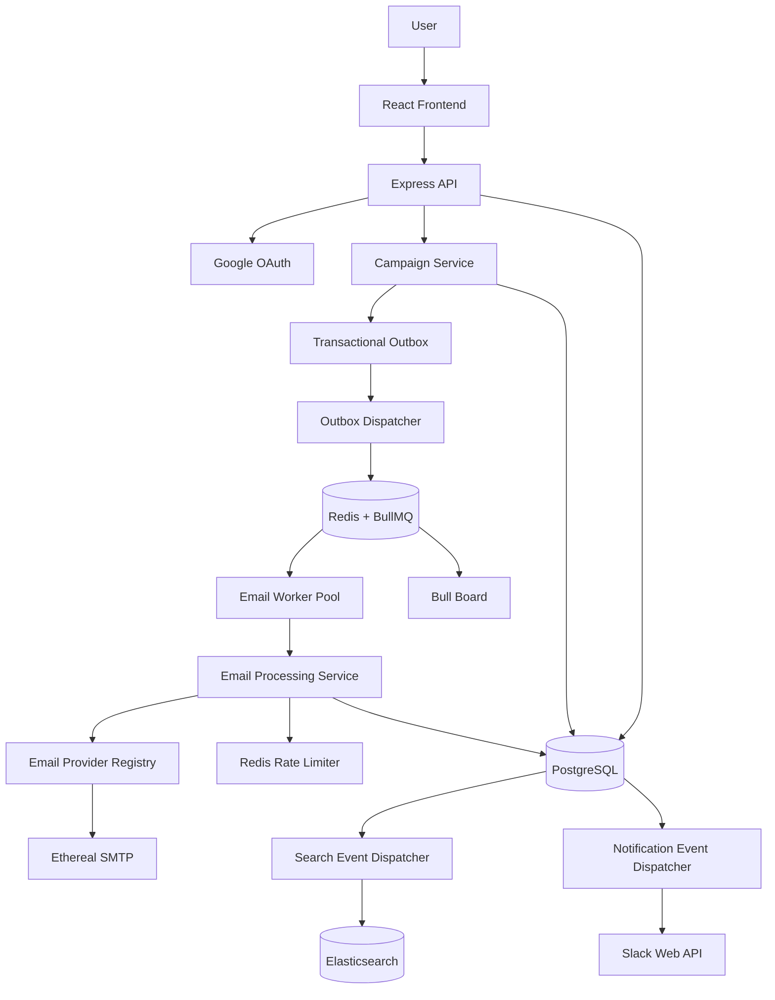
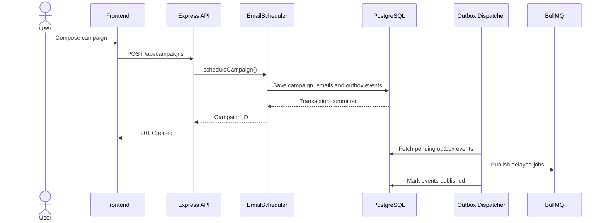
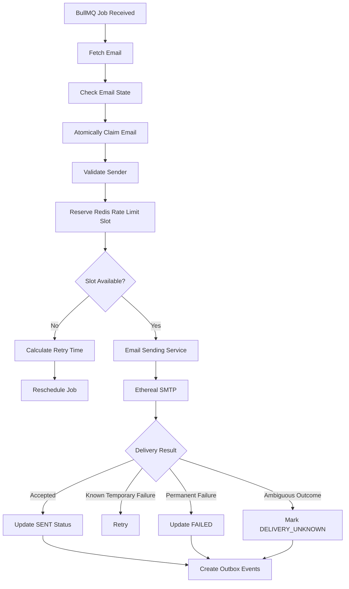
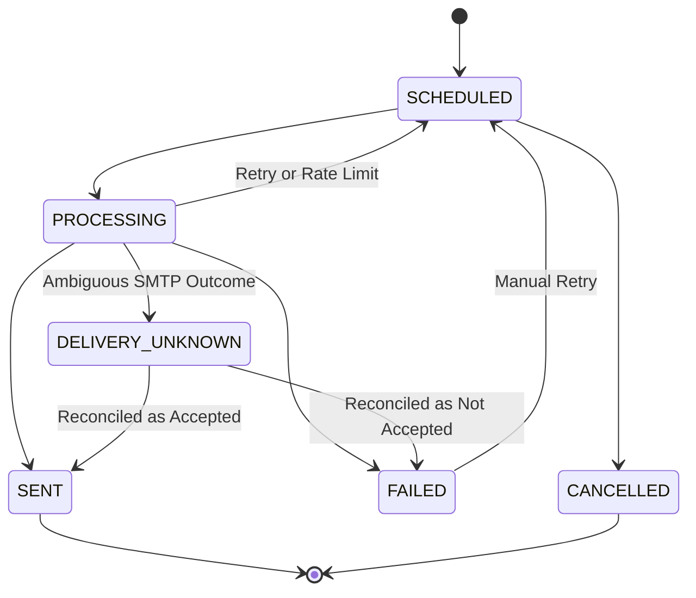
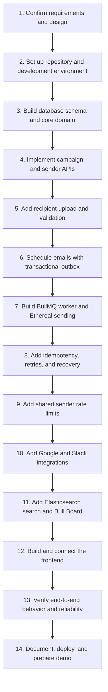

# ReachInbox — High-Level Design (HLD) & Low-Level Design (LLD)

**Project:** Full-Stack Email Job Scheduler  
**Organization:** ReachInbox (Outbox Labs)  
**Backend:** TypeScript, Node.js, Express.js  
**Frontend:** React.js, TypeScript, Tailwind CSS  
**Database:** PostgreSQL  
**Queue:** BullMQ + Redis  
**Search:** Elasticsearch  
**Email Provider:** Ethereal SMTP  

---

# Part 1: High-Level Design (HLD)

## 1. Project Overview

ReachInbox Email Scheduler is a distributed email scheduling system that allows users to upload email leads, compose campaigns and schedule emails for future delivery.

The system provides:

- Email scheduling through REST APIs.
- Persistent job execution using BullMQ and Redis.
- Multiple sender support.
- Configurable worker concurrency.
- Sender-specific hourly rate limiting.
- Minimum delay between email sends.
- Email delivery through Ethereal SMTP.
- Google OAuth authentication.
- Slack notifications when rate limits are reached.
- Elasticsearch-powered email search.
- A real-time queue monitoring dashboard.
- Recovery after application or worker restarts.

## 2. Functional Requirements

### 2.1 Authentication
- Login using Google OAuth 2.0.
- Display user name, email and avatar.
- Logout functionality.

### 2.2 Email Campaign Management
- Create email campaigns.
- Enter subject and body.
- Upload CSV/text files containing recipients.
- Validate and count email addresses.
- Configure start time.
- Configure minimum delay between emails.
- Configure hourly sending limit.
- Select sender account.

### 2.3 Email Scheduling
- Schedule individual emails using BullMQ delayed jobs.
- Persist scheduled emails in PostgreSQL.
- Support multiple simultaneous campaigns.
- Maintain execution order as much as possible.

### 2.4 Email Processing
- Configurable worker concurrency.
- Multiple sender support.
- Minimum delay between sends.
- Sender-specific hourly limits.
- Retry transient failures.
- Prevent duplicate processing.

### 2.5 Notifications
- Connect Slack using OAuth.
- Notify users when sender hourly limits are reached.
- Support disconnect and reconnect.
- Avoid duplicate notifications.

### 2.6 Search and Monitoring
- Search emails using Elasticsearch.
- Filter by recipient, subject, campaign and status.
- Monitor queue activity using Bull Board.

## 3. Non-Functional Requirements

| Requirement | Design |
|---|---|
| Reliability | PostgreSQL + persistent BullMQ jobs |
| Scalability | Independent worker processes |
| Concurrency | Configurable BullMQ concurrency |
| Idempotency | Unique keys + atomic database claims |
| Rate limiting | Redis atomic operations |
| Maintainability | Modular architecture |
| Extensibility | Interfaces and design patterns |
| Search performance | Elasticsearch |
| Security | OAuth, encrypted credentials, protected APIs |
| Recovery | Outbox dispatcher and reconciliation |

## 4. Technology Stack

| Layer | Technology |
|---|---|
| Frontend | React + TypeScript |
| Styling | Tailwind CSS |
| Backend | Node.js + Express + TypeScript |
| ORM | Prisma |
| Database | PostgreSQL |
| Queue | BullMQ |
| Queue storage | Redis |
| Search | Elasticsearch |
| Email | Nodemailer + Ethereal |
| Authentication | Google OAuth 2.0 |
| Notifications | Slack OAuth + Slack Web API |
| Queue monitoring | Bull Board |
| Deployment | Docker Compose |

## 5. High-Level Architecture



### 5.1 Architectural Components

**Frontend**

Responsible for authentication, campaign creation, email management and displaying scheduled/sent emails.

**Express API**

Handles incoming requests, validation, authentication and application services.

**PostgreSQL**

The authoritative source of truth for users, senders, campaigns, emails and integration credentials.

**Redis + BullMQ**

Responsible for delayed jobs, background execution, queue persistence and distributed rate-limit state.

**Worker Pool**

Processes individual email jobs independently of the API server.

**Ethereal SMTP**

Provides fake SMTP delivery for testing.

**Elasticsearch**

Maintains a searchable projection of email records.

**Slack Integration**

Sends rate-limit notifications to connected users.

**Bull Board**

Provides real-time queue visibility.

## 6. Email Scheduling Workflow



### Scheduling Formula

For recipient index `i`:

\[
T_i = T_{start} + (i \times D)
\]

Where:

- `T_start` = campaign start time.
- `D` = configured delay between emails.
- `i` = recipient index starting from zero.

Each recipient receives an independent BullMQ job.

The delay is calculated as:

```typescript
const delay = Math.max(
    0,
    scheduledAt.getTime() - Date.now()
);
```

BullMQ handles the delayed execution without cron jobs.

## 7. Email Processing Workflow



## 8. Rate Limiting Architecture

Two restrictions must be enforced:

1. Minimum delay between consecutive email sends.
2. Maximum number of emails sent per hour per sender.

Example configuration:

```env
WORKER_CONCURRENCY=10
MIN_EMAIL_DELAY_SECONDS=2
MAX_EMAILS_PER_HOUR_PER_SENDER=200
```

Redis stores distributed rate-limit counters.

Example keys:

```text
rate_limit:{senderId}:{hourWindow}
last_send:{senderId}
slack_alert:{senderId}:{hourWindow}
```

Use an atomic Redis Lua script to:

- Check hourly sending capacity.
- Check minimum delay.
- Reserve a sending slot.
- Return the next eligible execution time if blocked.

When the hourly limit is reached:

- Do not permanently fail the email.
- Reschedule it to the next available hour window.
- Generate one Slack notification per sender/hour window.
- Preserve ordering as much as possible.

## 9. Persistence and Recovery

The architecture uses three complementary mechanisms:

**PostgreSQL**
- Stores authoritative email and campaign states.
- Stores transactional outbox events.

**Redis + BullMQ**
- Persists queue jobs and delayed execution data.
- Recovers stalled jobs according to BullMQ configuration.

**Reconciliation**
- Runs during worker startup.
- Identifies scheduled emails that have no corresponding queue job.
- Republishes missing jobs through the outbox mechanism.
- Does not re-enqueue completed emails.

SMTP cannot guarantee exactly-once delivery. An ambiguous SMTP result must not automatically trigger a blind resend.

## 10. Elasticsearch Architecture

PostgreSQL remains the source of truth.

Elasticsearch stores a searchable representation of email records.

Supported search fields:

- Recipient.
- Subject.
- Campaign ID.
- Sender ID.
- Email status.
- Scheduled timestamp.
- Sent timestamp.

Indexing happens asynchronously through transactional outbox events.

---

# Part 2: Low-Level Design (LLD)

## 11. Module Structure

```text
reachinbox/
│
├── frontend/
│   └── src/
│       ├── components/
│       ├── pages/
│       ├── hooks/
│       ├── services/
│       ├── context/
│       └── types/
│
├── backend/
│   ├── src/
│   │   ├── config/
│   │   ├── controllers/
│   │   ├── middleware/
│   │   │
│   │   ├── modules/
│   │   │   ├── auth/
│   │   │   ├── users/
│   │   │   ├── senders/
│   │   │   ├── campaigns/
│   │   │   ├── emails/
│   │   │   ├── scheduler/
│   │   │   ├── workers/
│   │   │   ├── rate-limiter/
│   │   │   ├── notifications/
│   │   │   ├── search/
│   │   │   └── outbox/
│   │   │
│   │   ├── queues/
│   │   ├── integrations/
│   │   ├── repositories/
│   │   ├── services/
│   │   ├── events/
│   │   ├── utils/
│   │   ├── app.ts
│   │   ├── server.ts
│   │   └── worker.ts
│   │
│   ├── prisma/
│   ├── docker-compose.yml
│   └── package.json
│
└── README.md
```

## 12. Core Domain Models

### 12.1 User

```typescript
interface User {
    id: string;
    name: string;
    email: string;
    googleId: string;
    avatar?: string;
    createdAt: Date;
}
```

### 12.2 Sender

```typescript
interface Sender {
    id: string;
    userId: string;

    email: string;

    smtpHost: string;
    smtpPort: number;
    smtpUsername: string;
    smtpPassword: string;

    hourlyLimit: number;
    minDelaySeconds: number;

    isActive: boolean;
}
```

SMTP credentials must be encrypted at rest.

### 12.3 Campaign

```typescript
enum CampaignStatus {
    DRAFT = "DRAFT",
    SCHEDULED = "SCHEDULED",
    PROCESSING = "PROCESSING",
    COMPLETED = "COMPLETED",
    PARTIALLY_FAILED = "PARTIALLY_FAILED",
    FAILED = "FAILED",
    CANCELLED = "CANCELLED"
}

interface Campaign {
    id: string;
    userId: string;
    senderId: string;

    subject: string;
    body: string;

    startTime: Date;
    delayBetweenEmails: number;
    hourlyLimit: number;

    status: CampaignStatus;
}
```

### 12.4 Email

```typescript
enum EmailStatus {
    SCHEDULED = "SCHEDULED",
    PROCESSING = "PROCESSING",
    SENT = "SENT",
    FAILED = "FAILED",
    DELIVERY_UNKNOWN = "DELIVERY_UNKNOWN",
    CANCELLED = "CANCELLED"
}

interface Email {
    id: string;
    campaignId: string;
    senderId: string;

    recipient: string;
    subject: string;
    body: string;

    scheduledAt: Date;
    sentAt?: Date;

    status: EmailStatus;

    idempotencyKey: string;

    retryCount: number;
    errorMessage?: string;
}
```

### 12.5 SlackIntegration

```typescript
interface SlackIntegration {
    id: string;
    userId: string;

    accessToken: string;
    teamId: string;

    connected: boolean;
}
```

### 12.6 OutboxEvent

```typescript
interface OutboxEvent {
    id: string;
    aggregateId: string;
    eventType: string;
    payload: object;

    status: "PENDING" | "PUBLISHED";
    createdAt: Date;
    publishedAt?: Date;
}
```

---

## 13. Database Design

### Users

| Column | Type | Constraint |
|---|---|---|
| id | UUID | Primary key |
| name | VARCHAR | NOT NULL |
| email | VARCHAR | UNIQUE |
| google_id | VARCHAR | UNIQUE |
| avatar | TEXT | Nullable |
| created_at | TIMESTAMP | |

### Senders

| Column | Type | Constraint |
|---|---|---|
| id | UUID | Primary key |
| user_id | UUID | Foreign key |
| email | VARCHAR | NOT NULL |
| smtp_host | VARCHAR | NOT NULL |
| smtp_port | INTEGER | NOT NULL |
| smtp_username | VARCHAR | NOT NULL |
| smtp_password | TEXT | Encrypted |
| hourly_limit | INTEGER | NOT NULL |
| min_delay_seconds | INTEGER | NOT NULL |
| is_active | BOOLEAN | Default true |

### Campaigns

| Column | Type | Constraint |
|---|---|---|
| id | UUID | Primary key |
| user_id | UUID | Foreign key |
| sender_id | UUID | Foreign key |
| subject | VARCHAR | NOT NULL |
| body | TEXT | NOT NULL |
| start_time | TIMESTAMP | NOT NULL |
| delay_between_emails | INTEGER | NOT NULL |
| hourly_limit | INTEGER | NOT NULL |
| status | VARCHAR | NOT NULL |

### Emails

| Column | Type | Constraint |
|---|---|---|
| id | UUID | Primary key |
| campaign_id | UUID | Foreign key |
| sender_id | UUID | Foreign key |
| recipient | VARCHAR | NOT NULL |
| subject | VARCHAR | NOT NULL |
| body | TEXT | NOT NULL |
| scheduled_at | TIMESTAMP | NOT NULL |
| sent_at | TIMESTAMP | Nullable |
| status | VARCHAR | NOT NULL |
| idempotency_key | VARCHAR | UNIQUE |
| retry_count | INTEGER | Default 0 |
| error_message | TEXT | Nullable |

### Slack Integrations

| Column | Type | Constraint |
|---|---|---|
| id | UUID | Primary key |
| user_id | UUID | Foreign key |
| access_token | TEXT | Encrypted |
| team_id | VARCHAR | NOT NULL |
| connected | BOOLEAN | Default true |

### Email Events

Stores individual delivery attempts and status history.

### Outbox Events

Stores events waiting to be published to BullMQ or external integrations.

### Rate Limit Events

Stores sender-specific rate-limit events and Slack notification deduplication information.

### Important Indexes

```sql
CREATE INDEX idx_email_status_scheduled
ON emails(status, scheduled_at);

CREATE INDEX idx_email_campaign
ON emails(campaign_id);

CREATE INDEX idx_email_sender
ON emails(sender_id);

CREATE UNIQUE INDEX idx_email_idempotency
ON emails(idempotency_key);
```

---

## 14. Class Design

### 14.1 Repository Layer

Repository interfaces separate database operations from business logic.

```typescript
interface IEmailRepository {

    create(email: Email): Promise<Email>;

    findById(id: string): Promise<Email | null>;

    findByIdempotencyKey(
        key: string
    ): Promise<Email | null>;

    claimForProcessing(
        id: string
    ): Promise<boolean>;

    updateStatus(
        id: string,
        status: EmailStatus
    ): Promise<void>;
}
```

```typescript
interface ICampaignRepository {

    create(campaign: Campaign): Promise<Campaign>;

    findById(id: string): Promise<Campaign | null>;

    updateStatus(
        id: string,
        status: CampaignStatus
    ): Promise<void>;
}
```

```typescript
interface ISenderRepository {

    findById(id: string): Promise<Sender | null>;

    findByUserId(userId: string): Promise<Sender[]>;
}
```

Prisma implementations:

- `PrismaEmailRepository`
- `PrismaCampaignRepository`
- `PrismaSenderRepository`

### 14.2 Email Scheduler

Responsibilities:

- Validate campaign scheduling configuration.
- Create individual email records.
- Calculate scheduled timestamps.
- Persist records and outbox events in one database transaction.

```typescript
interface IEmailQueue {
    add(
        emailId: string,
        delay: number
    ): Promise<void>;
}
```

```typescript
class EmailScheduler {

    constructor(
        private emailRepo: IEmailRepository,
        private queue: IEmailQueue
    ) {}

    async scheduleCampaign(
        campaign: Campaign,
        recipients: string[]
    ): Promise<void> {

        // Persist emails and outbox events.
        // Calculate scheduled times.
        // Outbox dispatcher publishes jobs.
    }
}
```

### 14.3 Email Provider Strategy

```typescript
interface IEmailProvider {

    send(
        email: Email,
        sender: Sender
    ): Promise<EmailSendResult>;
}
```

```typescript
interface EmailSendResult {
    accepted: boolean;
    messageId?: string;

    error?: {
        code: string;
        message: string;
        retryable: boolean;
        outcomeUnknown: boolean;
    };
}
```

Implementations:

```typescript
class EtherealEmailProvider
    implements IEmailProvider {

    async send(
        email: Email,
        sender: Sender
    ): Promise<EmailSendResult> {

        // Nodemailer + Ethereal SMTP.
    }
}
```

Future providers can implement the same interface.

### 14.4 Email Provider Registry

```typescript
class EmailProviderRegistry {

    constructor(
        private providers: Map<string, IEmailProvider>
    ) {}

    get(provider: string): IEmailProvider {

        const instance = this.providers.get(provider);

        if (!instance) {
            throw new Error("Provider not registered");
        }

        return instance;
    }
}
```

The registry receives implementations through dependency injection.

### 14.5 Email Sending Service

Responsibilities:

- Obtain the correct provider.
- Execute the provider operation.
- Normalize delivery results.
- Classify delivery errors.

```typescript
class EmailSendingService {

    constructor(
        private registry: EmailProviderRegistry
    ) {}

    async send(
        email: Email,
        sender: Sender
    ): Promise<EmailSendResult> {

        const provider = this.registry.get("ETHEREAL");

        return provider.send(email, sender);
    }
}
```

### 14.6 Redis Rate Limiter

```typescript
interface RateLimitResult {
    allowed: boolean;
    retryAt?: Date;

    reason?: "HOURLY_LIMIT" | "MIN_DELAY";
}
```

```typescript
interface IRateLimiter {

    reserveSendSlot(
        senderId: string,
        hourlyLimit: number,
        minDelaySeconds: number
    ): Promise<RateLimitResult>;
}
```

```typescript
class RedisRateLimiter implements IRateLimiter {

    async reserveSendSlot(
        senderId: string,
        hourlyLimit: number,
        minDelaySeconds: number
    ): Promise<RateLimitResult> {

        // Execute atomic Redis Lua script.
        // Check hourly counter.
        // Check minimum delay.
        // Reserve slot or return retryAt.
    }
}
```

The reservation must be atomic across all workers.

### 14.7 Email Validation Service

```typescript
class EmailValidator {

    async validate(email: Email): Promise<boolean> {

        // Validate recipient.
        // Validate sender.
        // Validate required fields.
    }
}
```

### 14.8 Email Status Service

```typescript
class EmailStatusService {

    constructor(
        private emailRepo: IEmailRepository
    ) {}

    async transition(
        emailId: string,
        nextStatus: EmailStatus
    ): Promise<void> {

        // Validate allowed state transition.
        // Persist state change.
    }
}
```

### 14.9 Email Processing Service

This service coordinates the processing of an individual email.

```typescript
class EmailProcessingService {

    constructor(
        private validator: EmailValidator,
        private rateLimiter: IRateLimiter,
        private sender: EmailSendingService,
        private statusManager: EmailStatusService
    ) {}

    async process(emailId: string): Promise<void> {

        // 1. Fetch email.
        // 2. Validate and claim email.
        // 3. Check idempotency.
        // 4. Fetch sender.
        // 5. Reserve rate-limit slot.
        // 6. Reschedule if blocked.
        // 7. Send email.
        // 8. Update email status.
        // 9. Create appropriate outbox events.
    }
}
```

### 14.10 BullMQ Worker

The worker delegates business logic to the processing service.

```typescript
class EmailWorker {

    constructor(
        private processingService: EmailProcessingService
    ) {}

    async handle(emailId: string): Promise<void> {

        await this.processingService.process(emailId);
    }
}
```

BullMQ manages job execution, concurrency and stalled-job recovery.

---

## 15. Slack Notification Design

### Interface

```typescript
interface INotificationService {

    notifyRateLimitReached(
        senderId: string,
        userId: string,
        retryAt: Date
    ): Promise<void>;
}
```

### Adapter

```typescript
interface ISlackClient {

    sendMessage(
        channel: string,
        message: string
    ): Promise<void>;
}
```

```typescript
class SlackWebApiAdapter implements ISlackClient {

    async sendMessage(
        channel: string,
        message: string
    ): Promise<void> {

        // Slack Web API implementation.
    }
}
```

### Slack Notification Service

```typescript
class SlackNotificationService
    implements INotificationService {

    constructor(
        private slackClient: ISlackClient
    ) {}

    async notifyRateLimitReached(
        senderId: string,
        userId: string,
        retryAt: Date
    ): Promise<void> {

        // Check Slack connection.
        // Deduplicate notification.
        // Send message.
    }
}
```

Slack notifications are published asynchronously and must not block email delivery.

---

## 16. Email State Machine



### State Rules

- SENT emails cannot be processed again.
- PROCESSING emails require an active claim or processing lease.
- Rate-limited emails return to SCHEDULED.
- Permanent failures transition to FAILED.
- Ambiguous SMTP outcomes transition to DELIVERY_UNKNOWN.
- Unknown outcomes must not be blindly retried.

---

## 17. Transactional Outbox Pattern

### Problem

PostgreSQL and Redis cannot provide a single atomic transaction.

A crash can occur after saving an email but before publishing its BullMQ job.

### Solution

Save business records and outbox events in the same PostgreSQL transaction.

```typescript
await prisma.$transaction(async (tx) => {

    const campaign = await tx.campaign.create({
        data: campaignData
    });

    const emails = await tx.email.createMany({
        data: emailRecords
    });

    await tx.outboxEvent.createMany({
        data: outboxEvents
    });

});
```

An independent dispatcher:

1. Fetches pending events.
2. Publishes jobs to BullMQ.
3. Uses deterministic job IDs.
4. Marks events as published.
5. Retries failed publishing attempts.

Use database row locking, such as `FOR UPDATE SKIP LOCKED`, to coordinate multiple dispatchers.

The same outbox mechanism can publish email indexing and notification events.

---

## 18. Event-Driven Architecture

Define domain events such as:

```typescript
enum EmailEventType {
    EMAIL_SCHEDULED = "EMAIL_SCHEDULED",
    EMAIL_SENT = "EMAIL_SENT",
    EMAIL_FAILED = "EMAIL_FAILED",
    RATE_LIMIT_REACHED = "RATE_LIMIT_REACHED"
}
```

Event handlers:

```text
EMAIL_SENT
    |
    +----> SearchIndexHandler
    |
    +----> EmailHistoryHandler

EMAIL_FAILED
    |
    +----> SearchIndexHandler
    |
    +----> EmailHistoryHandler

RATE_LIMIT_REACHED
    |
    +----> SlackNotificationHandler
```

Events should be persisted before asynchronous publication.

---

## 19. API Design

### Authentication

| Method | Endpoint | Purpose |
|---|---|---|
| GET | `/auth/google` | Start Google OAuth |
| GET | `/auth/google/callback` | OAuth callback |
| POST | `/auth/logout` | Logout |
| GET | `/api/auth/me` | Current user |

### Campaigns

| Method | Endpoint | Purpose |
|---|---|---|
| POST | `/api/campaigns` | Create campaign |
| GET | `/api/campaigns` | List campaigns |
| GET | `/api/campaigns/:id` | Campaign details |
| POST | `/api/campaigns/:id/cancel` | Cancel campaign |

### Emails

| Method | Endpoint | Purpose |
|---|---|---|
| GET | `/api/emails/scheduled` | Scheduled emails |
| GET | `/api/emails/sent` | Sent emails |
| GET | `/api/emails/failed` | Failed emails |
| GET | `/api/emails/:id` | Email details |
| GET | `/api/emails/search` | Search emails |

### Senders

| Method | Endpoint | Purpose |
|---|---|---|
| GET | `/api/senders` | List senders |
| POST | `/api/senders` | Add sender |
| PUT | `/api/senders/:id` | Update sender |
| DELETE | `/api/senders/:id` | Remove sender |

### Slack

| Method | Endpoint | Purpose |
|---|---|---|
| GET | `/api/slack/connect` | Start Slack OAuth |
| GET | `/api/slack/callback` | OAuth callback |
| DELETE | `/api/slack/disconnect` | Disconnect Slack |

### Monitoring

| Method | Endpoint | Purpose |
|---|---|---|
| GET | `/admin/queues` | Bull Board dashboard |

All application endpoints must enforce authentication and user-level authorization.

---

## 20. Error Handling and Retry Strategy

| Error | Handling |
|---|---|
| Invalid recipient | Mark failed |
| SMTP temporary rejection | Retry |
| SMTP permanent rejection | Mark failed |
| Ambiguous SMTP outcome | DELIVERY_UNKNOWN |
| Redis unavailable | Retry infrastructure operation |
| Hourly limit exceeded | Reschedule |
| Minimum delay not satisfied | Reschedule |
| Slack unavailable | Retry notification independently |
| Elasticsearch unavailable | Retry indexing |
| Worker crash | BullMQ recovery + reconciliation |

### Exponential Backoff

\[
Delay = \min(2^n \times 1000,\ MaxDelay)
\]

Example with a maximum of 60 seconds:

| Attempt | Delay |
|---|---:|
| 1 | 2 seconds |
| 2 | 4 seconds |
| 3 | 8 seconds |
| 4 | 16 seconds |
| 5 | 32 seconds |

Only retry errors known to be safe to retry automatically.

---

## 21. SOLID Principles

| Principle | Implementation |
|---|---|
| SRP | Separate scheduler, validator, rate limiter, sender and notification services |
| OCP | Add new providers through IEmailProvider and registry |
| LSP | All email providers follow the same delivery contract |
| ISP | Small interfaces for repository, provider and notification operations |
| DIP | Services depend on interfaces rather than Prisma, Redis or SMTP implementations |

### Dependency Injection

High-level services should depend on abstractions:

```typescript
class EmailProcessingService {

    constructor(
        private emailRepo: IEmailRepository,
        private rateLimiter: IRateLimiter,
        private emailSender: IEmailProvider
    ) {}
}
```

Concrete implementations are supplied through the application composition root.

---

## 22. Design Patterns

| Pattern | Implementation | Purpose |
|---|---|---|
| Strategy | IEmailProvider | Interchangeable SMTP providers |
| Factory / Registry | EmailProviderRegistry | Provider creation and lookup |
| Repository | IEmailRepository | Database abstraction |
| Dependency Injection | Service construction | Loose coupling |
| Adapter | SlackWebApiAdapter | External API abstraction |
| State Machine | EmailStatusService | Valid email transitions |
| Observer / Event-driven | Event handlers | Asynchronous side effects |
| Transactional Outbox | OutboxDispatcher | Reliable event publishing |
| Chain of Responsibility | Optional validation pipeline | Independent validation handlers |

Avoid introducing patterns where they don't provide an actual benefit.

---

## 23. Concurrency and Idempotency

### Database Claim

Use an atomic conditional update to ensure only one worker claims an email.

Conceptually:

```sql
UPDATE emails
SET status = 'PROCESSING'
WHERE id = $1
AND status = 'SCHEDULED';
```

Only a worker that successfully updates one row owns the processing claim.

Use a processing lease or attempt record for crash recovery.

### BullMQ Job ID

Use a deterministic job ID derived from the email ID:

```typescript
jobId: `email-${email.id}`
```

### Idempotency

Maintain a unique database idempotency key.

Before processing:

1. Check the email state.
2. Atomically claim the email.
3. Reject already completed jobs.
4. Record delivery attempts.
5. Avoid automatic retries after ambiguous SMTP acceptance.

BullMQ job deduplication and database idempotency solve different problems; both are required.

---

## 24. Testing Strategy

### Unit Tests

- EmailScheduler scheduling calculations.
- EmailValidator.
- RedisRateLimiter logic.
- EmailProvider implementations.
- EmailStatusService.
- SlackNotificationService.

### Integration Tests

- PostgreSQL repository operations.
- BullMQ delayed job creation.
- Redis atomic rate limiting.
- Ethereal SMTP sending.
- Elasticsearch indexing.
- Slack OAuth and notification calls.

### Reliability Tests

- Restart API while emails are scheduled.
- Restart worker during processing.
- Simulate 1,000 simultaneous jobs.
- Hit sender hourly limits.
- Simulate Redis downtime.
- Simulate Elasticsearch downtime.
- Simulate duplicate BullMQ jobs.
- Simulate ambiguous SMTP outcomes.

---

# Part 3: Implementation Roadmap

## Phase 1 — Project Foundation

- Create frontend and backend projects.
- Configure TypeScript.
- Configure PostgreSQL and Prisma.
- Configure Redis and Docker Compose.
- Establish module structure.

## Phase 2 — Core Email Scheduling

- Implement User, Sender, Campaign and Email models.
- Implement repositories.
- Implement campaign API.
- Implement CSV parsing.
- Implement EmailScheduler.
- Integrate BullMQ delayed jobs.
- Integrate Ethereal SMTP.

## Phase 3 — Worker and Reliability

- Implement EmailWorker.
- Implement EmailProcessingService.
- Implement provider interfaces.
- Implement EmailStatusService.
- Implement idempotency.
- Implement Transactional Outbox.
- Implement restart recovery.

## Phase 4 — Rate Limiting and Concurrency

- Implement RedisRateLimiter.
- Implement atomic Redis Lua reservation.
- Configure worker concurrency.
- Implement minimum send delay.
- Implement hourly sender limits.
- Implement delayed rescheduling.

## Phase 5 — External Integrations

- Implement Google OAuth.
- Implement Slack OAuth.
- Implement SlackNotificationService.
- Implement Elasticsearch indexing.
- Implement search APIs.
- Integrate Bull Board.

## Phase 6 — Frontend

- Implement login.
- Implement dashboard.
- Implement compose email.
- Implement CSV upload and validation.
- Implement scheduled emails table.
- Implement sent emails table.
- Implement error and loading states.

## Phase 7 — Testing and Submission

- Unit and integration tests.
- Load and concurrency testing.
- Restart recovery testing.
- Slack notification demonstration.
- README documentation.
- Private GitHub repository.
- Five-minute demo video.

---

# Part 4: Architectural Decisions and Assumptions

| Decision | Selected approach |
|---|---|
| Architecture | Modular monolith |
| API and worker | Separate processes |
| Database source of truth | PostgreSQL |
| Scheduling | BullMQ delayed jobs |
| Queue persistence | Redis |
| Email granularity | One job per recipient |
| Email provider | Ethereal SMTP |
| Provider abstraction | Strategy + Registry |
| Rate-limit scope | Per sender |
| Rate-limit storage | Redis |
| Minimum delay | Configurable |
| Search | Elasticsearch |
| Event publishing | Transactional Outbox |
| Notifications | Slack OAuth + Web API |
| State management | Email State Machine |
| ORM | Prisma |
| Deployment | Docker Compose |

### Assumptions

1. Each email belongs to one campaign and one sender.
2. Each campaign has one selected sender.
3. Campaign-level hourly limits and sender-level limits are both configurable. The effective limit is the lower applicable limit.
4. The minimum delay and hourly limit are enforced across all workers sharing the same sender.
5. Email scheduling order is preserved as much as possible, subject to sender limits and concurrency.
6. Elasticsearch is not the source of truth.
7. Slack notification failures do not interrupt email delivery.
8. Ambiguous SMTP outcomes are not automatically resent.
9. OAuth tokens and SMTP credentials are encrypted.
10. The actual frontend styling will be finalized after receiving the Figma reference.

---

# Part 5: Definition of Done

The project will be considered complete when:

- [ ] Google login works.
- [ ] Users can create email campaigns.
- [ ] CSV recipients are parsed and validated.
- [ ] Emails are persisted in PostgreSQL.
- [ ] BullMQ schedules delayed jobs.
- [ ] Ethereal SMTP sends emails.
- [ ] Multiple senders are supported.
- [ ] Worker concurrency is configurable.
- [ ] Minimum delay is enforced.
- [ ] Hourly rate limits work across workers.
- [ ] Rate-limited jobs are rescheduled.
- [ ] Slack notifications work through real OAuth.
- [ ] Elasticsearch search works.
- [ ] Bull Board displays queue information.
- [ ] Duplicate processing is prevented.
- [ ] Restart recovery works.
- [ ] Frontend displays scheduled and sent emails.
- [ ] README and demo video are complete.

**Final architectural direction:** A modular monolith with separate API and worker processes, PostgreSQL as the source of truth, Redis/BullMQ for scheduling and execution, and event-driven integrations for search and notifications.
# Part 6: Project Execution Flow

This section describes the order of work for delivering the ReachInbox Email Scheduler. Each phase produces a working foundation for the next phase.



## Phase 1 — Confirm requirements and design

- Review the Figma reference and agree on the screens and user journey.
- Confirm campaign rules, sender settings, CSV format, and email states.
- Record environment variables and external credentials needed for local development.

**Deliverable:** Agreed scope, user flow, and configuration checklist.

## Phase 2 — Set up repository and development environment

- Create the frontend and backend projects with TypeScript.
- Configure linting, formatting, environment loading, and logging.
- Start PostgreSQL, Redis, and Elasticsearch through Docker Compose.
- Add health checks and confirm that each service is reachable.

**Deliverable:** A running local development environment and project skeleton.

## Phase 3 — Build database schema and core domain

- Define Prisma models, enums, relations, and indexes for users, senders, campaigns, emails, and outbox events.
- Add encrypted credential fields and safe configuration handling.
- Run the initial database migration and seed development data.

**Deliverable:** The database can persist and retrieve the core records.

## Phase 4 — Implement campaign and sender APIs

- Add authentication middleware and user-level authorization.
- Build sender create, list, update, and delete operations.
- Build campaign creation, listing, detail, and cancellation operations.
- Validate request data and return consistent error responses.

**Deliverable:** Authenticated API operations for managing senders and campaigns.

## Phase 5 — Add recipient upload and validation

- Accept CSV or text recipient uploads.
- Parse addresses, normalize values, and report invalid or duplicate entries.
- Validate campaign content, start time, sender selection, and rate settings.

**Deliverable:** A campaign can be prepared with a verified recipient list.

## Phase 6 — Schedule emails reliably

- Create the campaign and its email records in a database transaction.
- Calculate each recipient's scheduled time from campaign start time and configured delay.
- Write queue events to the transactional outbox in the same transaction.
- Publish outbox events to BullMQ using deterministic job IDs.

**Deliverable:** Scheduled emails persist and are reliably published to the queue.

## Phase 7 — Build worker and email delivery

- Run the worker as a separate process from the API.
- Fetch and atomically claim each scheduled email before processing.
- Send through the Ethereal SMTP provider using the provider interface.
- Save successful delivery, permanent failure, or ambiguous outcome to PostgreSQL.

**Deliverable:** Queued emails are processed and their outcomes are recorded.

## Phase 8 — Add idempotency, retries, and recovery

- Prevent a second worker from claiming an email already being processed.
- Retry only errors known to be safe to retry, with bounded backoff.
- Use a processing lease or attempt record to recover work after a worker crash.
- Reconcile scheduled database records with BullMQ jobs after startup.
- Keep ambiguous SMTP outcomes out of automatic resend paths.

**Deliverable:** Duplicate jobs and process restarts do not cause unsafe duplicate sends.

## Phase 9 — Enforce sender rate limits

- Implement an atomic Redis reservation for the hourly limit and minimum delay.
- Apply the lower applicable campaign and sender hourly limit.
- Reschedule blocked work for its next eligible time without marking it failed.
- Deduplicate rate-limit events for notification purposes.

**Deliverable:** All workers enforce shared sender limits consistently.

## Phase 10 — Add Google and Slack integrations

- Implement Google OAuth login and logout.
- Store integration credentials encrypted and protect integration routes.
- Connect Slack and publish rate-limit notifications asynchronously.
- Ensure Slack failures do not block email delivery.

**Deliverable:** Users can sign in and receive deduplicated Slack alerts.

## Phase 11 — Add search and queue monitoring

- Publish email change events through the outbox to Elasticsearch.
- Support search and filtering by recipient, subject, campaign, sender, status, and dates.
- Mount Bull Board behind administrator authentication.

**Deliverable:** Users can find email records and authorized operators can inspect queue health.

## Phase 12 — Build and connect the frontend

- Implement login and authenticated application layout.
- Build sender management and campaign composition screens.
- Add recipient upload, validation feedback, and scheduling controls.
- Show campaign progress and scheduled, sent, failed, and unknown emails.
- Connect screens to the backend APIs and handle loading and error states.

**Deliverable:** Users can operate the main email scheduling journey through the UI.

## Phase 13 — Verify end-to-end behavior and reliability

- Walk through login, sender setup, campaign creation, scheduling, sending, and search.
- Verify hourly and minimum-delay limits with multiple workers.
- Exercise cancellation, retries, duplicate jobs, and service restarts.
- Confirm ambiguous delivery outcomes are visible and not blindly resent.

**Deliverable:** A verified end-to-end system with recovery behavior understood.

## Phase 14 — Document, deploy, and prepare demo

- Document setup, environment variables, architecture, and operating instructions.
- Prepare deployment configuration and secrets management.
- Capture the required demo of the completed user journey and key reliability features.

**Deliverable:** A documented, deployable project ready for handoff.

## Critical dependency path

```text
Requirements and UI decisions
  → Project and service setup
  → Database and domain models
  → Campaign APIs and recipient validation
  → Transactional scheduling and queue publishing
  → Worker and email delivery
  → Reliability and rate limiting
  → Integrations and search
  → Frontend completion
  → End-to-end verification and handoff
```

The frontend can be developed alongside backend phases once API contracts and screen behavior are agreed. End-to-end verification depends on the database, queue, worker, and core campaign flow being connected.
